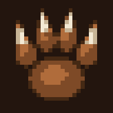
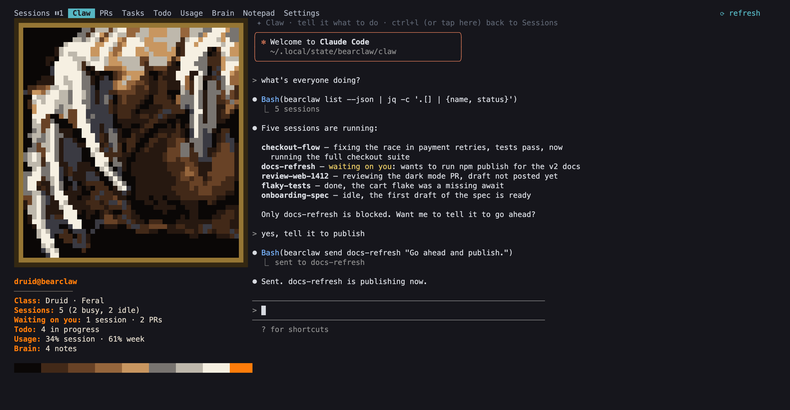
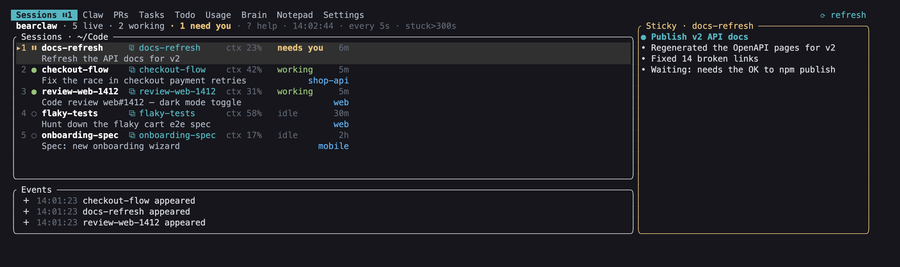
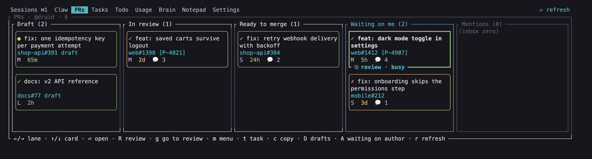

<p align="center"></p>

# bearclaw

A terminal dashboard for running many Claude Code sessions at once. See what every session is
doing, answer the ones waiting on you, review the PRs that need you, and let **Claw**, an
operator session, drive the rest for you.



`bearclaw` is one Rust binary (the CLI and the dashboard) plus a small web app for your phone. It
finds every live Claude Code session on a machine, in tmux panes or iTerm tabs, straight from
Claude Code's own registry. [Codex](https://github.com/openai/codex) and [pi](https://pi.dev)
sessions are found and driven too.

## What's in the dashboard

Run `bearclaw` in a terminal. The tabs along the top are **Sessions · Claw · PRs · Tasks · Todo ·
Usage · Brain · Notepad · Settings**. Switch with Tab / Shift+Tab, Shift+←/→, or a click.

**Sessions.** Every live session, whether it is working, idle or waiting on you, how full its
context is, and the sticky note it keeps about its own progress. Enter opens a tmux session
inside the dashboard as a full terminal, where Shift+Enter gives a newline and dragging the mouse
selects and copies text. Ctrl+L takes you back to the list while the session keeps running. `c`
starts a new session.



**Claw.** A Claude session whose job is running bearclaw. Ask it "what's everyone doing?", tell
it to send a session a message, start a new one, or fill in everyone's todo and sticky notes. It
asks before it messages, starts or closes anything. Next to it is a character card with the
numbers that matter right now: sessions, what is waiting on you, todo, usage and brain notes.

**PRs.** A kanban of the pull requests that need you: drafts, in review, ready to merge, waiting
on you, and mentions. It comes from [tb-pr](https://github.com/productiveio/cli-toolbox) when
that is installed, from `gh` otherwise. The board refreshes on its own while you look at it.
Shift+R on a card starts a code review session for that PR in the background, and the card links
to it (`g` or a click opens it). `m` opens a menu of everything you can do with a card.



**Todo.** The one-line work list. Every session keeps its own item current, linked to the
session and its task, so you can see who is on what and jump to them.

**Brain.** A folder of markdown notes (`~/brain`) that every Claude Code session on the machine
reads before it starts and writes to when it learns something worth keeping. The tab browses,
searches and edits them.

**Usage, Tasks, Notepad, Settings.** Your Claude subscription limits, your open
[Productive](https://productive.io) tasks, your own notes, and the config.

All keys per tab: [docs/cli.md → Dashboard keys](docs/cli.md#dashboard-keys-watch).

## How it works

- **Discovery.** Claude Code writes a registry entry for every running session
  (`~/.claude/sessions/`) and keeps its status current. bearclaw reads it, matches each session to
  its tmux pane or iTerm tab, and reads the transcript tail for context use. Nothing has to be installed into the
  sessions themselves.
- **Driving.** Sending a message types it into the session's terminal (tmux `send-keys`, or
  AppleScript for iTerm). Starting one opens a new tmux session running `claude`.
- **Shared state.** The todo list, sticky notes and brain are plain files under
  `~/.local/state/bearclaw` and `~/brain`. A SessionStart hook (`bearclaw brain install`) tells
  every new session how to keep them current.
- **More machines.** It can also run your sessions on an always-on Mac (the *workstation*) over
  ssh. Every command takes `-H <host>`, and `bearclaw` re-runs itself there. The web UI serves
  its own sessions and merges in its peers', so one URL on your phone shows everything.

```
  laptop                         phone                           workstation (always on)
 ┌──────────────────────┐      ┌──────────────────┐            ┌──────────────────────────────┐
 │ bearclaw <cmd>       │      │ browser / PWA    │            │ tmux server (24/7)           │
 │  ├─ local sessions   │      │ bearclaw web UI  │            │  ├─ job-a: claude            │
 │  └─ -H workstation ──┼─ssh──┼──────────────────┼──────────▶ │  ├─ job-b: claude            │
 │                      │      │                  │   http     │  └─ bearclaw: bearclaw (TUI) │
 │ bearclaw web serve   │◀─────┼── http ──────────┼──────────▶ │ bearclaw web serve :7777     │
 └──────────────────────┘ peer │                  │  (tailnet) └──────────────────────────────┘
            ▲                  └──────────────────┘                        ▲
            └─────────────── Tailscale (WireGuard mesh, private IPs) ──────┘
```

Details: [docs/architecture.md](docs/architecture.md).

## Install

Requirements: macOS (the only tested platform), tmux, Claude Code, and a Rust toolchain to build
([rustup](https://rustup.rs); the repo pins the version). The web UI needs Node ≥ 22, and more
than one machine needs Tailscale and ssh between them.

```sh
git clone https://github.com/ivanzatez/bearclaw && cd bearclaw
cargo install --path crates/bearclaw     # installs `bearclaw` into ~/.cargo/bin
bearclaw init                            # this machine's name, hosts, spawn dirs, web port
bearclaw brain install                   # the SessionStart hook for the brain, todo and sticky notes
bearclaw                                 # the dashboard
```

If linking fails with "You have not agreed to the Xcode license agreements", run
`sudo xcodebuild -license accept`, or build against the Command Line Tools:
`DEVELOPER_DIR=/Library/Developer/CommandLineTools cargo install --path crates/bearclaw`.

For the phone: `bearclaw web build`, then `bearclaw web serve` on each machine, and open
`http://<tailscale-ip>:7777`. It looks like the dashboard (the Claw theme: monospace, the same
colours) and has its tabs along the top: Sessions, Claw (chat with it, under the druid's card),
PRs (with Review on a card), Tasks, Todo, Memory (the brain) and Notepad (both editable),
Settings. Usage is on the Claw card. Over HTTPS (`tailscale serve`) and added to the Home Screen, it
also sends notifications when a session waits on you or finishes. Setting up an always-on workstation from scratch:
[docs/setup.md](docs/setup.md).

## Commands

Everything the dashboard does is also a command, so scripts, other agents and Claw itself can use
it.

```sh
bearclaw list                              # sessions on this machine (-a: every host)
bearclaw peek docs-refresh                 # what that session shows right now
bearclaw send docs-refresh "run the tests" # type into it and press Enter
bearclaw spawn "fix the flaky spec" --dir ~/Code/web
bearclaw todo                              # the work list
bearclaw pr spawn web#1412 "review this"   # check a PR out in a worktree and start a session on it
bearclaw restore                           # bring sessions back after a reboot
```

| area | commands |
| --- | --- |
| Claude sessions | `list` · `peek` · `send` · `rename` · `name` · `spawn` · `handoff` · `watch` (the dashboard) · `skill` |
| work list | `todo` · `sticky` · `brain` |
| tmux sessions | `tmux list\|enter\|last\|new\|kill\|rename\|stale` (alias `t`), shortcuts `enter` · `last` · `new` |
| after a reboot | `restore`: the sessions that were running, brought back with the same tmux layout and `claude --resume` |
| pull requests | `prs` · `pr checkout` · `pr spawn` · `pr cleanup-worktrees` |
| git repos | `repos` · `repos sync` · `repos install-service`: fetch and fast-forward every repo under your code folder, on a timer |
| scheduled jobs | `jobs` · `jobs show\|run\|enable\|disable` · `jobs install-service`: agent sessions on a cron schedule |
| hosts and setup | `exec` · `ssh` · `doctor` · `init` · `config` · `install --host <name>` |
| web | `web serve` · `web build` · `web install-service` |
| agents | `mcp`: every command above as an MCP tool |

Global flags: `-H, --host <name>`, `--local`, `--json`. Full reference: [docs/cli.md](docs/cli.md).

## Docs

- [docs/cli.md](docs/cli.md): every command, the dashboard keys, the config
- [docs/architecture.md](docs/architecture.md): components, discovery, JSON contracts, extension points
- [docs/setup.md](docs/setup.md): an always-on workstation, Tailscale, ssh, tmux and the phone, end to end
- [docs/desktop.md](docs/desktop.md): the web UI as a macOS app
- [web/](web/): the web server and its HTTP API

## Security

The web app has **no authentication**. Keep it reachable only over your tailnet: bind it to the
Tailscale interface or firewall it, and never expose it publicly. Anyone who can reach the port
can type into your Claude sessions. See [docs/setup.md#security](docs/setup.md#security).

## License

MIT, see [LICENSE](LICENSE). bearclaw started from [Ivan Lučin](https://github.com/ilucin)'s
session supervisor, and parts of it come from
[productiveio/cli-toolbox](https://github.com/productiveio/cli-toolbox).
